# Apetec — Sistema de Achados e Perdidos Escolar

API RESTful + frontend desenvolvido como TCC para substituir o sistema manual (papel) de achados e perdidos da escola por uma solução tecnológica.

## Sumário
- [Visão geral](#visão-geral)
- [Tecnologias](#tecnologias)
- [Como rodar](#como-rodar)
- [Estrutura do projeto](#estrutura-do-projeto)
- [Funcionalidades](#funcionalidades)
- [Rotas da API](#rotas-da-api)
- [Fluxos principais](#fluxos-principais)
- [Screenshots](#screenshots)
- [Documentação detalhada](#documentação-detalhada)

## Visão geral
O Apetec conecta alunos que perderam objetos à secretaria que encontra e cadastra itens. O fluxo cobre desde a abertura de chamado pelo aluno, passando pelo matching automático com itens encontrados, notificações, chat, reivindicação, entrega com código de retirada, até relatórios e auditoria.

## Tecnologias
- Python 3.10+
- FastAPI
- SQLModel / SQLAlchemy
- SQLite (dev) / PostgreSQL (prod, via `DATABASE_URL`)
- Uvicorn
- Supabase Storage (fotos)
- Resend (e-mail)
- Frontend: HTML/CSS/JS puro

## Como rodar
```bash
python -m venv venv
venv\Scripts\activate
pip install -r requirements.txt
```
Crie `.env` na raiz:
```
SECRET_KEY=sua-chave-secreta-aqui
RESEND_API_KEY=...          # opcional, para e-mails
SUPABASE_URL=...
SUPABASE_SERVICE_ROLE_KEY=...
SUPABASE_BUCKET=apetec-itens
SETUP_KEY=...              # para criar secretaria inicial
```
Rode:
```bash
uvicorn main:app --reload
```
Acesse: http://localhost:8000/docs

## Estrutura do projeto
```
apetec_v2/
├── main.py
├── app/
│   ├── models.py
│   ├── database.py
│   ├── auth.py
│   ├── audit.py
│   ├── supabase_storage.py
│   └── routers/
│       ├── auth.py
│       ├── usuarios.py
│       ├── itens.py
│       ├── chamado.py
│       ├── secretaria.py
│       └── notificacoes.py
├── frontend/
│   ├── dashboard.html
│   ├── dashboard-secretaria.html
│   ├── login.html
│   ├── register.html
│   ├── recuperar-senha.html
│   ├── js/auth.js
│   └── style/style.css
├── docs/
└── screenshots/
```

## Funcionalidades
- Cadastro/login de alunos e secretaria (JWT)
- Recuperação de senha por e-mail
- Confirmação de e-mail no cadastro
- Validação de CPF
- Cadastro de itens encontrados com foto (secretaria)
- Abertura de chamados de itens perdidos (aluno)
- Upload de foto no chamado
- Matching automático (score por tipo/cor/marca/local/data)
- Notificações por e-mail e in-app
- Chat/comentários por chamado
- Catálogo de itens para alunos + reivindicação
- Vínculo item↔chamado + código de retirada
- Entrega com validação de código
- Feedback pós-entrega
- Etiquetas/QR para objetos
- Relatórios e métricas
- Exportação CSV
- Expiração/doação de itens (+90 dias)
- Auditoria de ações
- Paginação e filtros avançados

## Rotas da API
- `/auth` — login, recuperação/reset de senha, confirmação de e-mail
- `/usuarios` — CRUD de alunos
- `/item` — CRUD de itens, foto, reivindicação, expiração, disponíveis
- `/chamados` — CRUD, sugestões, vínculo, entrega, foto, mensagens, feedback
- `/secretaria` — perfil, relatório, auditoria, exportação CSV
- `/notificacoes` — listar/marcar lida

Documentação completa: [docs/API.md](docs/API.md)

## Fluxos principais
1. Aluno perde item → abre chamado (opcionalmente com foto).
2. Secretaria encontra item → cadastra com foto.
3. Sistema faz matching automático e notifica alunos com chamados compatíveis.
4. Secretaria vincula item ao chamado → gera código de retirada e notifica aluno.
5. Aluno retira item apresentando código → secretaria marca como entregue.
6. Aluno pode avaliar o atendimento (feedback).
7. Itens não reclamados em 90 dias são marcados como doados.

## Screenshots
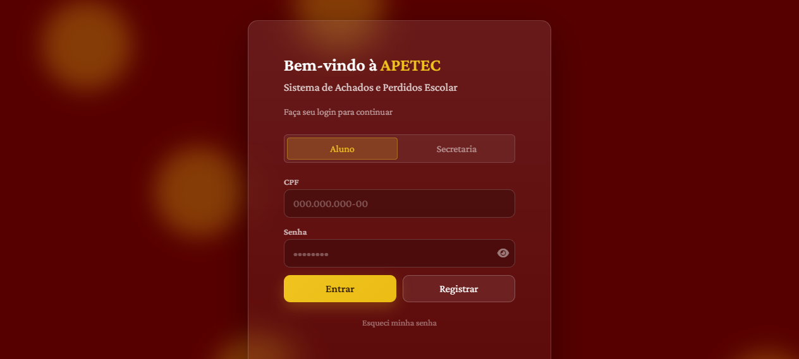
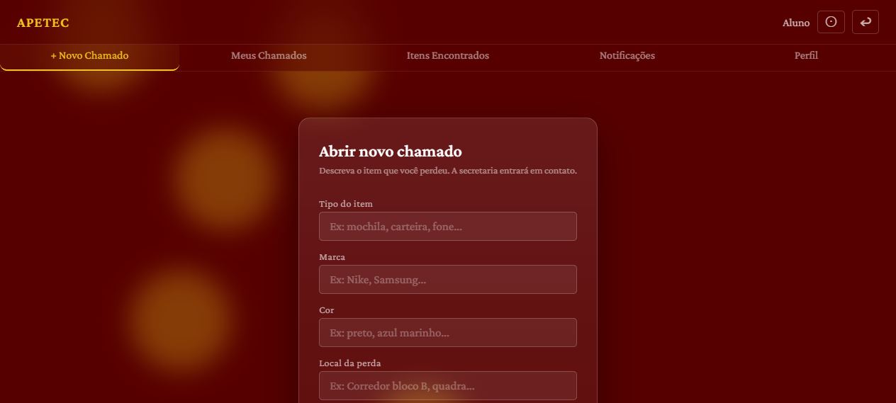
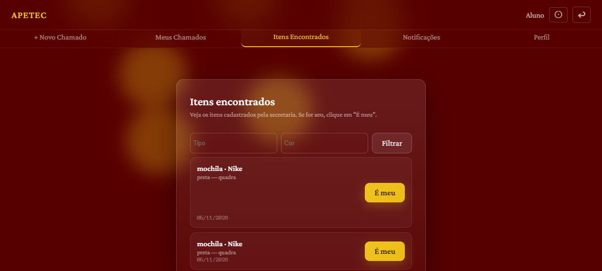
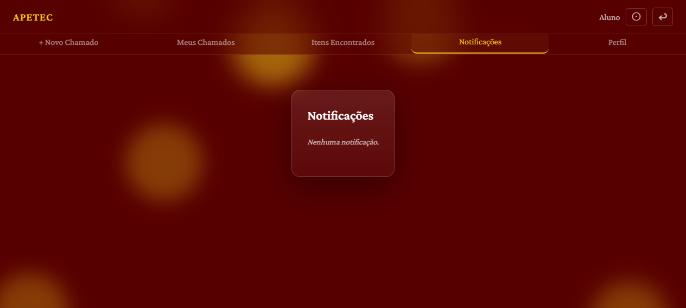
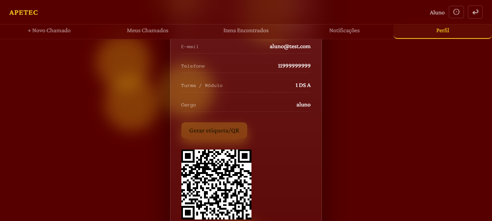
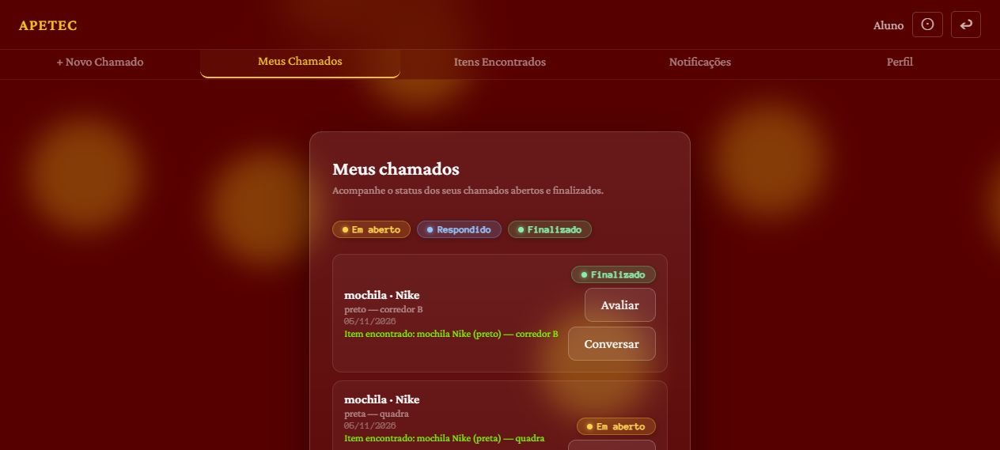
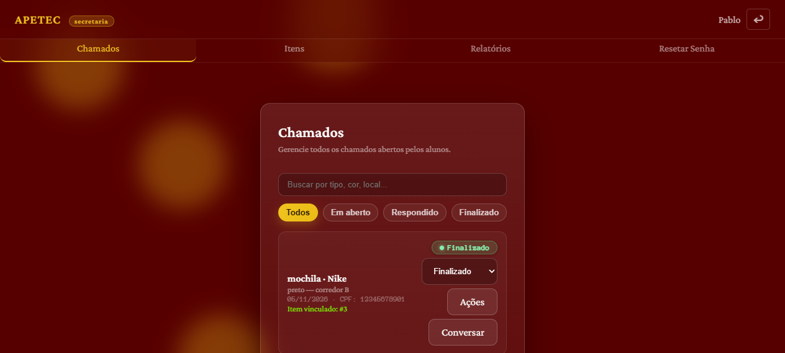
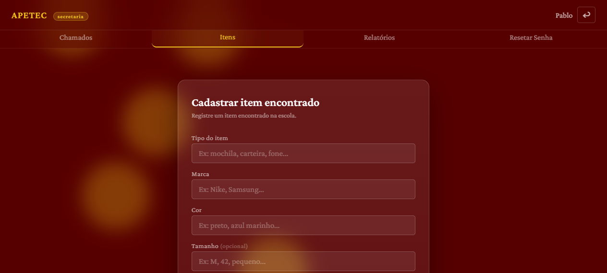
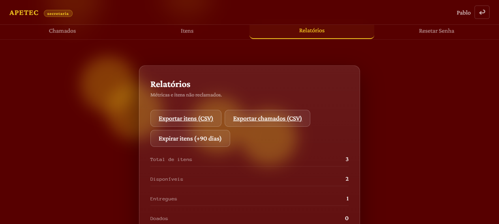
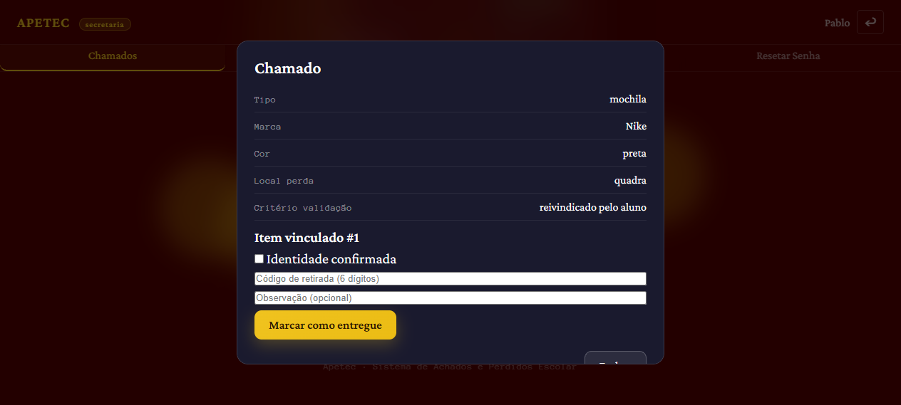
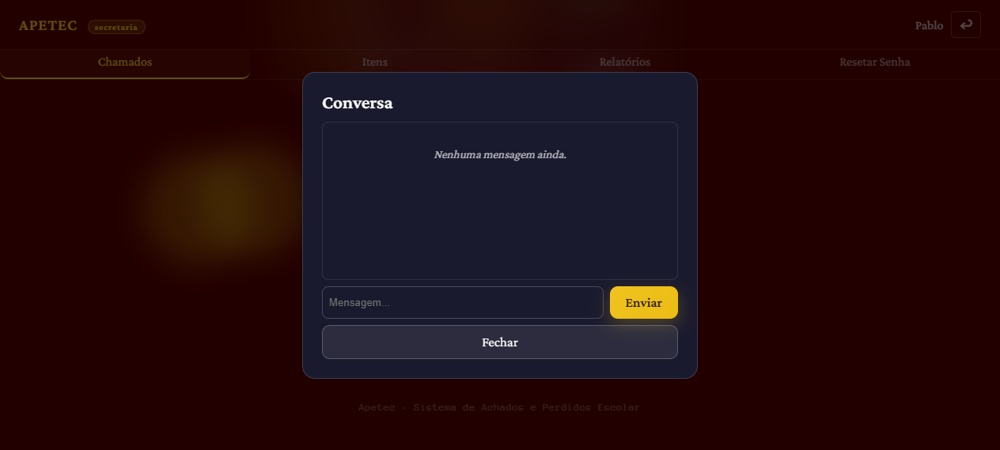

## Documentação detalhada
- [Arquitetura](docs/ARCHITECTURE.md)
- [API](docs/API.md)
- [Funcionalidades](docs/FEATURES.md)
