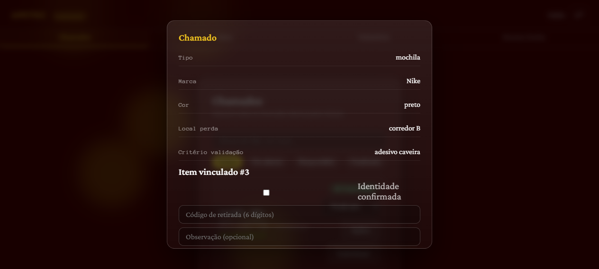
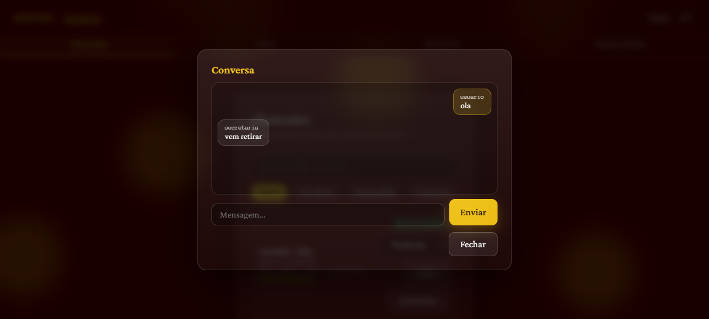
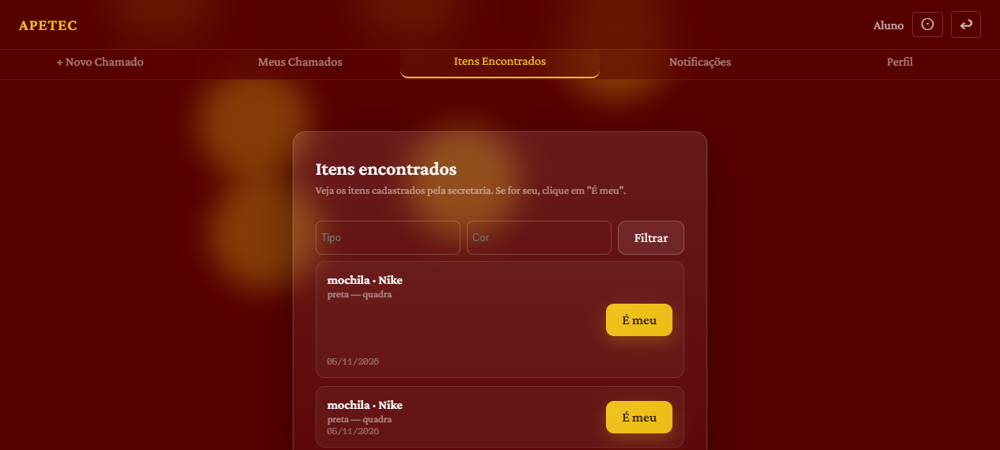
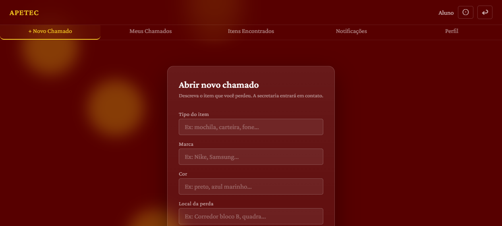

# Atualizações e Novidades — Apetec

Documento com as funcionalidades recentemente adicionadas/atualizadas, acompanhadas de capturas de tela.

## 1. Matching automático e notificações
- Score de compatibilidade entre chamados e itens (tipo, cor, marca, local, data).
- Notificações por e-mail e in-app ao aluno quando item compatível é cadastrado.
- Sugestões de itens no modal de ações da secretaria.

## 2. Vínculo e entrega com código de retirada
- Secretaria vincula item ao chamado; gera código de 6 dígitos.
- Entrega exige código de retirada + confirmação de identidade.
- Notificação ao aluno quando item pronto para retirada.

## 3. Chat por chamado
- Conversa aluno ↔ secretaria vinculada ao chamado.
- Notificação in-app ao receber mensagem.

## 4. Catálogo de itens para alunos
- Alunos visualizam itens encontrados disponíveis.
- Reivindicação de item ("É meu") cria chamado vinculado e notifica secretaria.
- Filtros por tipo/cor.

## 5. Notificações in-app
- Lista de notificações do usuário.
- Marcar como lida.

## 6. Relatórios e métricas (secretaria)
- Total de itens, disponíveis, entregues, doados, taxa de devolução.
- Chamados por status, itens não reclamados (+30 dias).
- Exportação CSV (itens e chamados).
- Expiração/doação de itens (+90 dias).

## 7. Auditoria
- Registro de ações (criar item, chamado, vínculo, entrega, feedback, etc.) com ator e timestamp.
- Endpoint `/secretaria/auditoria`.

## 8. Feedback pós-entrega
- Aluno avalia atendimento (nota 1–5 + comentário) após entrega.

## 9. Etiquetas/QR para objetos
- Geração de QR code com dados do aluno para colar em objetos.

## 10. Confirmação de e-mail e validação de CPF
- Cadastro exige CPF válido (11 dígitos).
- E-mail de confirmação enviado no cadastro.

## 11. Padronização visual dos modais
- Modais de ações, chat e confirmações alinhados ao tema (fundo marrom, acento amarelo, blur, Crimson Pro).

## 12. Upload de fotos
- Foto no item encontrado e no chamado (até 5MB, png/jpg/jpeg/webp/gif).

## 13. Paginação e filtros avançados
- skip/limit e filtros por tipo, cor, local, status nas listagens.

## 14. Documentação
- README reestruturado.
- Pasta `docs/` com arquitetura, API, funcionalidades e screenshots.

---

Screenshots completos em `screenshots/`.
