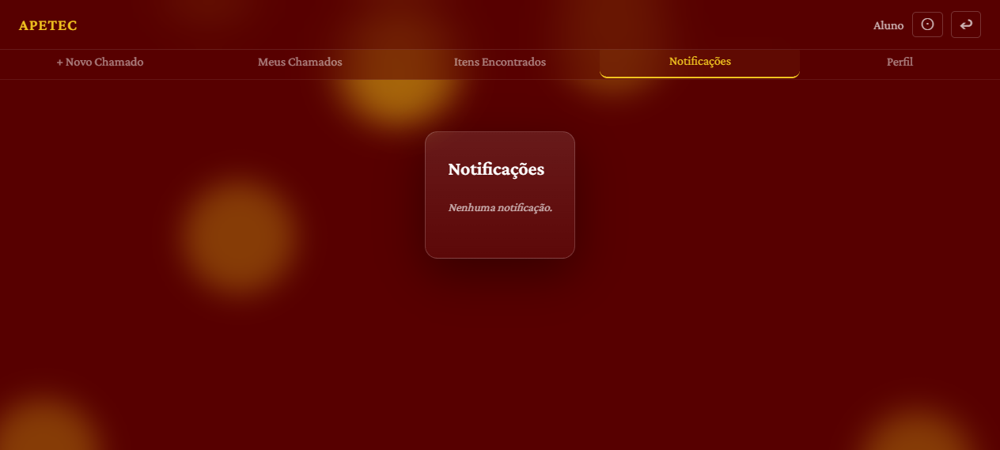
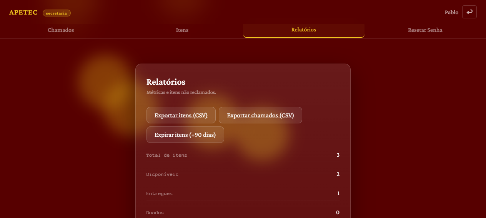
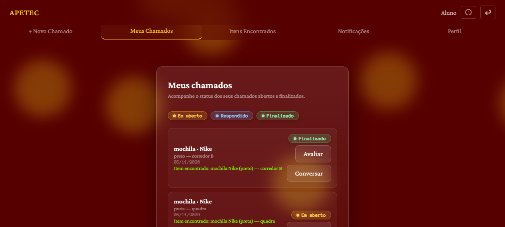
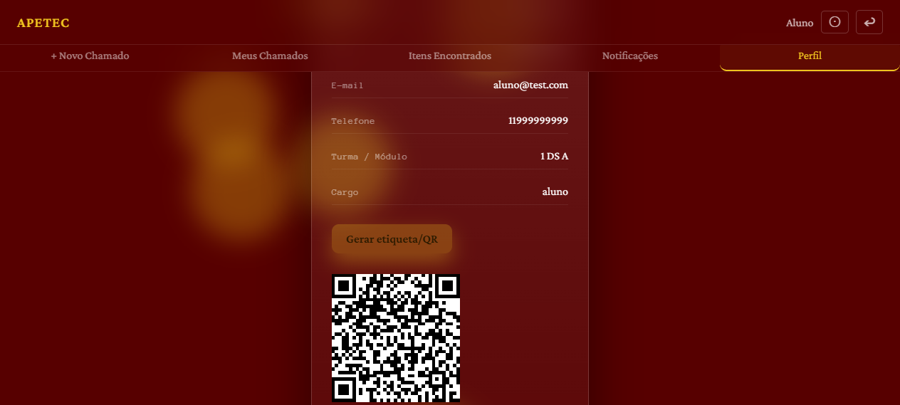

# O que mudou no Apetec

Aqui estão as novidades e melhorias que foram adicionadas ao sistema, com imagens de cada parte.

## 1. Encontrar itens automaticamente
O sistema agora compara chamados e itens encontrados por tipo, cor, marca, local e data. Quando um item compatível é cadastrado, o aluno recebe um e-mail e uma notificação no sistema.

## 2. Vincular e entregar com código
A secretaria vincula o item ao chamado e gera um código de 6 números. Para retirar, o aluno apresenta esse código. A entrega só é concluída após confirmar a identidade.

## 3. Conversa (chat)
Aluno e secretaria podem trocar mensagens dentro do chamado. Há notificação quando uma nova mensagem chega.

## 4. Itens encontrados para alunos
Os alunos veem os itens que a secretaria cadastrou e podem dizer "é meu". Isso cria um chamado e avisa a secretaria.

## 5. Notificações
Lista de avisos para o aluno, com opção de marcar como lido.

## 6. Relatórios para a secretaria
Mostra números: quantos itens, entregues, doados, taxa de devolução, chamados por status e itens esquecidos há mais de 30 dias. Também permite baixar planilhas (CSV) e marcar itens antigos como doados.

## 7. Histórico (auditoria)
Registra quem fez o quê e quando (cadastro, vínculo, entrega, etc.).

## 8. Avaliação após entrega
O aluno pode dar nota e comentário sobre o atendimento.

## 9. Etiqueta com QR Code
O aluno gera um QR code com seus dados para colar nos objetos, facilitando a identificação se perder.

## 10. Confirmação de e-mail
No cadastro, o CPF é validado e um e-mail de confirmação é enviado.

## 11. Visual dos modais
As janelas de ações, chat e confirmações ficaram com o mesmo estilo do sistema (fundo marrom, detalhes amarelos).

## 12. Fotos
Itens e chamados podem ter fotos (até 5MB).

## 13. Busca e filtros
É possível filtrar por tipo, cor, local e status nas listas.

## 14. Documentação
README reorganizado e pasta de documentação com explicações simples.

---

Todas as imagens estão na pasta `screenshots/`.
